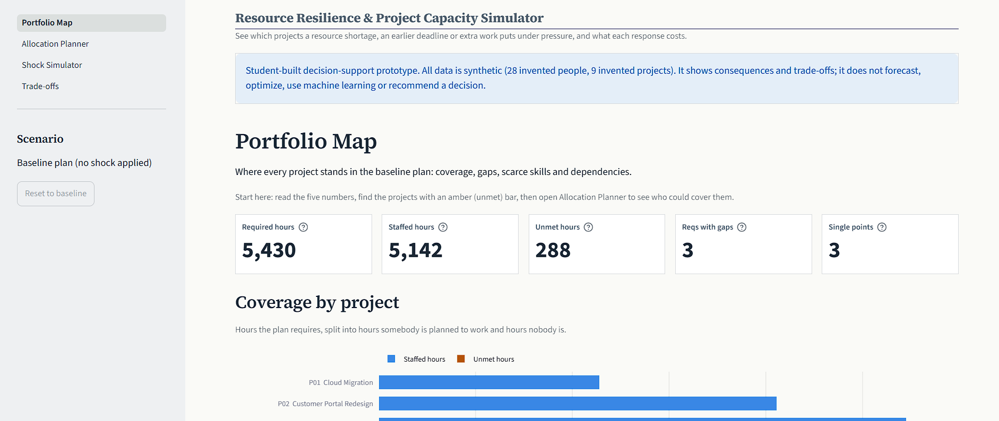
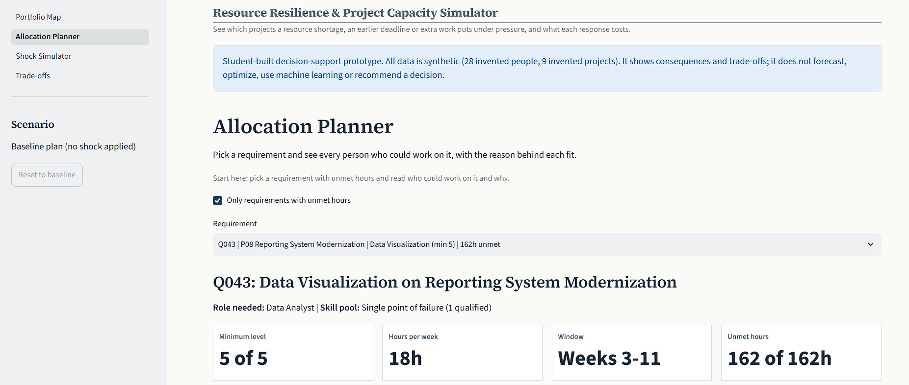
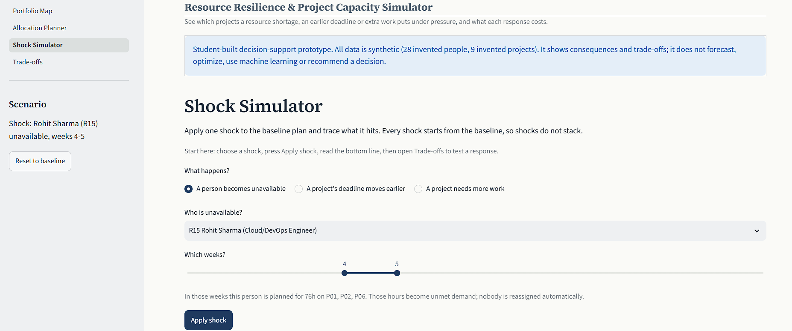
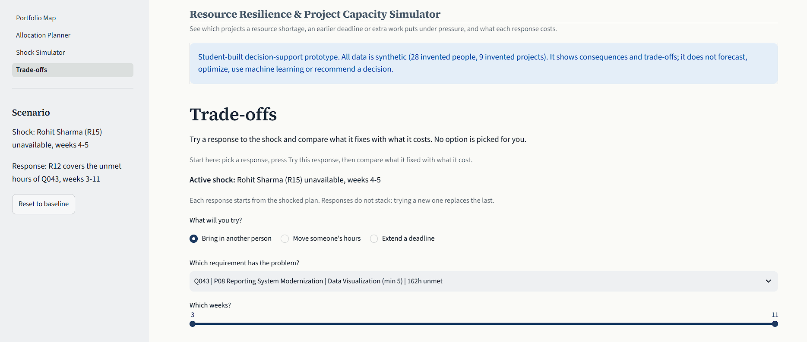

# 🧭 Resource Resilience & Project Capacity Simulator

A decision-support dashboard built with **Python**, **Streamlit**, **Pandas** and **Plotly** that shows what happens to a portfolio of projects when a person becomes unavailable, a deadline moves earlier, or a project needs more work, and what each possible response fixes and what it costs.

The project demonstrates how a program office can test the resilience of a staffing plan before something goes wrong: where the plan is already fragile, what a shock hits, and what each response costs, without any option being chosen for the user.

> ⚠️ **Data Disclaimer:** This is a **student-built prototype on synthetic, demonstration-only data**. All 28 people and 9 projects are invented. No real person, company or project is represented. The tool shows consequences and trade-offs. It does **not** forecast, optimize, use machine learning or AI, or recommend a decision.

---

## 🚀 Current Version

**Version:** `v1.0`
**Status:** ✅ Complete

---
## 🌐 Live Application

**Resource Resilience & Project Capacity Simulator:**
https://resource-resilience-simulator.streamlit.app

---
## 🖼️ Dashboard Preview

### Portfolio Map


### Allocation Planner


### Shock Simulator


### Trade-offs


---

## ❓ The Question It Answers

A program office has a plan: who works on which project, in which week. Then something goes wrong. The tool answers three questions about that plan:

1. **Where is the plan already fragile?** Which projects have hours nobody is planned to cover, and which skills depend on a single person?
2. **What does a shock hit?** If one person is out for two weeks, a deadline moves earlier, or a project grows by 20 %, which requirements lose cover, which projects become exposed through dependencies, and by how many hours?
3. **What does a response cost?** If you bring in another person, move someone's hours, or extend a deadline, what does that fix, and what does it break or leave open?

---

## ✅ Implemented Features

- 🗺️ Portfolio Map: required, staffed and unmet hours per project
- 🔗 Project dependency view and downstream exposure
- 🧍 Single-point-of-failure detection (skills only one person can cover)
- 🎯 Allocation Planner with candidate fit scores and plain-language reasons
- 🚩 Constraint explanations: insufficient hours, no availability, already fully allocated, below required proficiency, role mismatch
- ⚡ Shock Simulator with three shocks: person unavailable, earlier deadline, increased workload
- 🧩 Per-project status: Staffed, Gap, Large gap, Exposed
- 🔁 Trade-offs page with three responses: bring in another person, move someone's hours, extend a deadline
- 📊 Three-way comparison: baseline, after the shock, after the response
- 📝 "What it fixed / what it cost" reading, with qualification warnings for below-level staffing
- ↩️ Undo and reset to baseline
- 🛡️ Friendly error screens for missing or damaged data
- 🧪 440 automated tests

---

## 🛠️ Tech Stack

| Category | Tools |
|---|---|
| Programming Language | Python 3 |
| Framework | Streamlit |
| Data Processing | Pandas, NumPy |
| Data Visualization | Plotly |
| Data Source | Excel workbook (openpyxl) |
| Testing | pytest, Streamlit AppTest |
| Version Control | Git, GitHub |
| Development Environment | Visual Studio Code |
| Hosting | Streamlit Community Cloud |

---

## 📂 Project Structure

```text
resource-resilience-simulator/
│
├── app.py                      Main Streamlit app: setup, data checks, sidebar, navigation
│
├── app_pages/                  The four pages
│   ├── portfolio_map.py
│   ├── allocation_planner.py
│   ├── shock_simulator.py
│   └── tradeoffs.py
│
├── src/                        All logic (testable without Streamlit)
│   ├── data_loader.py
│   ├── validator.py
│   ├── capacity.py
│   ├── allocation.py
│   ├── dependencies.py
│   ├── scenarios.py
│   ├── responses.py
│   ├── planner_view.py
│   ├── portfolio_view.py
│   ├── shock_view.py
│   ├── tradeoffs_view.py
│   ├── app_state.py
│   └── theme.py
│
├── data/
│   └── resource_resilience_dataset_v2.xlsx
│
├── tests/                      440 automated tests
├── assets/                     Screenshots used in this README
├── .streamlit/config.toml
├── pytest.ini
├── requirements.txt
├── .gitignore
├── LICENSE
└── README.md
```

### Folder / File Reference

| File / Folder | Purpose |
|---|---|
| `app.py` | App shell: page setup, data loading and checking, sidebar, navigation, error screens |
| `app_pages/` | One file per page |
| `src/data_loader.py` | Reads the seven data sheets from the Excel workbook |
| `src/validator.py` | Checks the data and reports every problem in plain words |
| `src/capacity.py` | Capacity and demand per person and requirement, week by week |
| `src/allocation.py` | Qualification, candidate evaluation, fit score, constraint explanations |
| `src/dependencies.py` | Downstream exposure through project dependencies |
| `src/scenarios.py` | Baseline snapshot, the three shocks, baseline-vs-scenario comparison |
| `src/responses.py` | The three responses and how they are evaluated |
| `src/*_view.py` | Tables, text and charts behind each page |
| `src/app_state.py` | Shared app logic and per-page guidance text |
| `src/theme.py` | Visual theme |
| `data/` | Synthetic dataset and its data dictionary |
| `tests/` | Automated tests |
| `requirements.txt` | Python dependencies |

---

## ⚙️ Installation & Setup

### 1. Clone the repository
```bash
git clone https://github.com/gopichand-7/resource-resilience-simulator.git
cd resource-resilience-simulator
```

### 2. Create a virtual environment

**Windows**
```bash
python -m venv .venv
.venv\Scripts\activate
```

**macOS / Linux**
```bash
python3 -m venv .venv
source .venv/bin/activate
```

### 3. Install dependencies
```bash
pip install -r requirements.txt
```

### 4. Run the application
```bash
streamlit run app.py
```
The app will be available at `http://localhost:8501`. No API key or account is needed.

### 5. Run the tests
```bash
python -m pytest -q
```

---

## ☁️ Deployment

The application is deployed on **Streamlit Community Cloud**.

**Configuration**
- Repository: `gopichand-7/resource-resilience-simulator`
- Branch: `main`
- Main file: `app.py`
- Python version: `3.13`
- Secrets: none required

**Shipping an update**
```bash
git add .
git commit -m "Your update message"
git push
```

---

## ✨ Feature Details

### 🗺️ Portfolio Map
Reads the baseline plan: required, staffed and unmet hours per project, the open problems the engine found, scarce skills (single points of failure) and project dependencies.

### 🎯 Allocation Planner
Pick a requirement and see every person who could work on it, with a fit score and the reason behind it: skill level, free hours, load headroom, role, and flags such as *Below required proficiency*.

### ⚡ Shock Simulator
Apply one shock to the baseline and read the bottom line, a status for every project, the questions it leaves for the program owner, how it spreads through dependencies, and the exact conflicts that changed.

### 🔁 Trade-offs
Try one response to the active shock and compare baseline, after the shock and after the response, with a plain *what it fixed / what it cost* reading and the exact hours that moved.

---

## 🧠 How the Modelling Works

- **Shocks never stack.** Each shock starts from the baseline: a person unavailable for chosen weeks, a project deadline moved earlier, or a project's weekly demand raised by a percentage.
- **Responses never stack.** Each response starts from the shocked plan, and trying a new one replaces the last: substitute (add a person), reallocate (move someone's hours), or extend a deadline.
- **Nothing is re-planned automatically.** A person who becomes unavailable leaves their planned hours as unmet demand. Nobody is reassigned unless the user tries a response.
- **Fit score** = 50 × skill match + 30 × availability + 20 × load headroom, from 0 to 100, labelled Strong (75+), Partial (50+) or Constraint. These weights are simulation assumptions for this prototype, not industry standards. Someone below the minimum proficiency can never be better than Partial.
- **Status symbols:** ● Staffed, ▲ Gap, ■ Large gap (25 % or more of a project's hours unmet), ◇ Exposed (depends on a project with unmet hours). Exposure is a dependency, not a predicted delay.

---

## 🔬 Worked Example on the Synthetic Data

The baseline plan needs **5,430 hours** and staffs **5,142**, leaving **288 hours unmet**. Three people (R15, R06, R11) are the only qualified cover for at least one requirement each.

- **Shock:** the one Cloud/DevOps engineer (R15) is unavailable in weeks 4–5. Unmet hours rise from 288 to **364 (+76)**, requirements with gaps rise from 3 to 6, and exposed projects from 1 to 3.
- **Response A, bring in another person:** a second Cloud/DevOps engineer (R16) covers the affected requirement and unmet hours fall to 340. The cost is shown next to it.
- **Response B, extend a deadline:** moving P01's deadline from week 10 to week 12 **does not fix the plan**. It adds nobody and re-plans nobody, so unmet hours can rise (to 409 here). The tool says so rather than hiding it.

---

## 🧪 Testing

The test suite has **440 automated tests**:

- **Expected numbers are worked out by hand from the raw Excel file**, not copied from the program's output.
- **The real pages are run headlessly** with Streamlit's `AppTest`, including leaving a page and coming back, to check that nothing crashes and that choices are remembered.
- **Every response option on the Trade-offs page was exercised** across three different shocks.
- **The dataset was deliberately damaged in over a hundred ways** (columns deleted, text where numbers belong, empty cells) to confirm that the app shows a clear message and never a raw error.

---

## 🗃️ Data

`data/resource_resilience_dataset_v2.xlsx` contains seven data sheets (Resources, Resource_Skills, Projects, Project_Requirements, Allocations, Calendar, Dependencies) plus a Data Dictionary describing every column. It describes 28 invented people, 9 invented projects, 50 skill requirements and a 12-week calendar. The data has no health, risk or performance fields.

---

## 🚫 What This Is Not

- Not a forecast or a delay predictor. It shows exposure, not when anything will slip.
- Not an optimizer or a scheduler. It never chooses a person or a plan for you.
- Not machine learning or an AI assistant. Every number comes from simple, visible rules.
- Not an HR or payroll tool, and not a score of anyone's performance.

### Limitations and possible extensions
- The model is deliberately simple: weekly hours, whole requirements, one shock at a time, one response at a time.
- Costs are shown as hours and warnings, not money.
- Possible extensions: stacking shocks, skills that grow with training, a cost view, loading your own workbook with the same sheet layout.

---

## 🎯 Skills Demonstrated

Resource Planning · Capacity Planning · Project Portfolio Analysis · Risk and Scenario Analysis · Dependency Analysis · Decision Support · Trade-off Analysis · Python Programming · Pandas Data Analysis · Plotly Data Visualization · Streamlit Application Development · Test-Driven Validation · Automated Testing with pytest · Data Validation and Error Handling · Technical Documentation · Git and GitHub · Cloud Deployment

---

## 👨‍💻 Author

**Gopichand Kollapattu**
GitHub: [github.com/gopichand-7](https://github.com/gopichand-7)

---

## 📄 License

This project is licensed under the MIT License: free to use, modify, and distribute with attribution.
